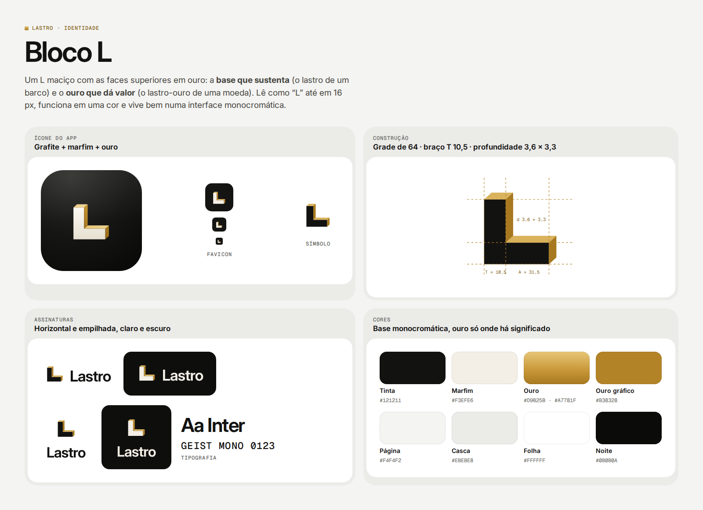

# Marca do Lastro — "Bloco L"

## Conceito

Um **L maciço com as faces superiores em ouro**. Duas leituras de *lastro* no mesmo desenho:

- a **base que sustenta** — o lastro que mantém um barco de pé (a reserva que faz você voltar ao prumo depois de um imprevisto);
- o **ouro que dá valor** — o lastro-ouro de uma moeda.

O bloco é tinta (ou marfim, no escuro) e o ouro aparece só nas arestas: a marca convive com a interface monocromática
sem disputar atenção, e o dourado fica reservado para o que tem significado.

## Arquivos

| Arquivo | Uso |
|---|---|
| `svg/lastro-simbolo.svg` · `svg/lastro-simbolo-escuro.svg` | Símbolo sozinho, fundo claro / escuro |
| `svg/lastro-assinatura-horizontal(-escuro).svg` | Símbolo + nome lado a lado (padrão) |
| `svg/lastro-assinatura-empilhada(-escuro).svg` | Símbolo sobre o nome (espaços quadrados) |
| `svg/lastro-icone-app.svg` | Ícone com cantos arredondados (grafite, marfim e ouro) |
| `svg/lastro-icone-app-quadrado.svg` | Ícone sangrado, para sistemas que arredondam sozinhos (iOS) |
| `svg/lastro-icone-maskable.svg` | Ícone com área de segurança, para Android ("maskable") |
| `svg/favicon.svg` | Favicon (quadrado escuro: legível em abas claras e escuras) |
| `png/` | Exportações prontas (ícone 1024 px, assinaturas a 256 px de altura) |

No app, os mesmos arquivos estão em `frontend/public/`: `favicon.svg`, `apple-touch-icon.png` (180),
`icon-192.png`, `icon-512.png`, `icon-maskable-512.png` e `manifest.webmanifest` (instalar na tela inicial).
O componente `BrandMark` (`frontend/src/components/Icon.tsx`) desenha o símbolo com as cores do tema.

## Construção

Grade de 64 unidades. Braço `T = 10,5`, comprimento `A = 31,5` (braços iguais), extrusão `d = 3,6 × 3,3`
para cima e para a direita. Face frontal com origem em `(14,25; 18,5)`; o conjunto fica levemente abaixo do
centro geométrico para compensar o peso visual da face escura.

O nome é a **Inter** (corte óptico display, peso 640, espaçamento −0,032 em), convertida em curvas nos SVGs com
kerning real; as coordenadas são inteiras e separadas por vírgula (o teste de higiene do repositório procura
sequências longas de dígitos). Na assinatura horizontal, a base do nome se alinha à base do bloco.

## Cores

| Papel | Claro | Escuro |
|---|---|---|
| Face frontal | Tinta `#121211` | Marfim `#F3EFE6` |
| Face superior (ouro claro) | `#D9B25B` | `#E3BD68` |
| Face lateral (ouro profundo) | `#A7781F` | `#B4852A` |
| Ícone do app | Grafite `#2E2E2B → #0A0A09`, marfim em degradê, ouro em degradê | — |

Na interface, o ouro de texto é `#835F14` (claro, ≥ 4,5:1) / `#E2BE6E` (escuro) e o ouro gráfico é `#B38328`.

## Uso

- **Respiro mínimo:** ¼ da altura do símbolo em volta de toda a marca.
- **Tamanho mínimo:** símbolo com 16 px; assinatura horizontal com 96 px de largura.
- **Fundos:** versão tinta sobre claros, versão marfim sobre escuros; em fotos ou fundos agitados, use o ícone do app.

Não faça: distorcer ou girar o bloco, trocar o ouro por outra cor, inverter a direção da extrusão, aplicar sombra,
contorno ou brilho extra, recompor o nome com outra fonte, usar o dourado em textos longos.

## Mascotes dos agentes (pixel art)

Sete robozinhos autorais, um por agente, desenhados numa grade 16×16 (`frontend/src/components/mascots.ts`) e
renderizados como SVG nítido (`shape-rendering: crispEdges`, fundo transparente) pelo componente `AgentAvatar`.

| Agente | Cor | Silhueta e acessório | Expressão |
|---|---|---|---|
| Mentor | grafite | coroa e gola douradas | atenta, sorriso discreto |
| Planejador | verde-sálvia | cabeça redonda, prancheta com checklist | gentil, olhar para a tarefa |
| Analista | azul | quadrado, monitor de gráfico de barras na cabeça | curiosa, olhar para cima |
| Economista | turquesa | anel orbital atravessando a cabeça, pequena lua | pensativa, boca de lado |
| Gestor de Riscos | terracota | largo e baixo, capacete com aleta, visor | desconfiada, mas simpática |
| Conselheiro | lilás | pequeno e redondo, coração, bochechas rosadas | olhos fechados de alegria |
| Auditor | cinza-azulado | alto e estreito, óculos quadrados | séria, uma sobrancelha erguida |

Regras comuns: contorno de 1 px, luz no alto à esquerda, sombra embaixo à direita, olhos 2×3 nas mesmas colunas,
paleta de 4 a 7 cores. No tema escuro o contorno vira um traço claro (`--mascot-outline`), para a silhueta não sumir
no fundo. Legíveis de 24 a 96 px (16 px por pixel da grade divide exatamente 32, 48, 64 e 96).

Animações (`styles/mascots.css`): piscar a cada ~7 s (fora de sincronia entre agentes, desligado abaixo de 24 px),
subir 1 px no hover, olhar de lado a lado enquanto pensa e um pulinho único quando começa a responder. Tudo é
desligado com `prefers-reduced-motion`. Quando o nome do agente já está escrito ao lado, o avatar é decorativo
(`aria-hidden`); sozinho, tem texto alternativo. Id desconhecido mostra as iniciais; o Lastro (avisos) usa o símbolo.

Galeria de comparação: `npm run dev` e abra `/dev/mascotes` (só existe no modo de desenvolvimento; o build de produção
não inclui a página).
